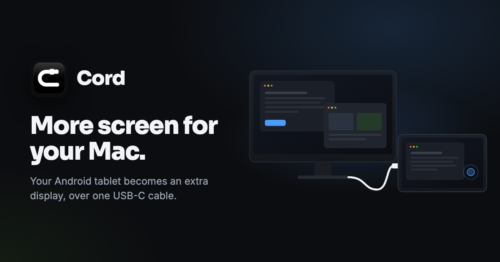
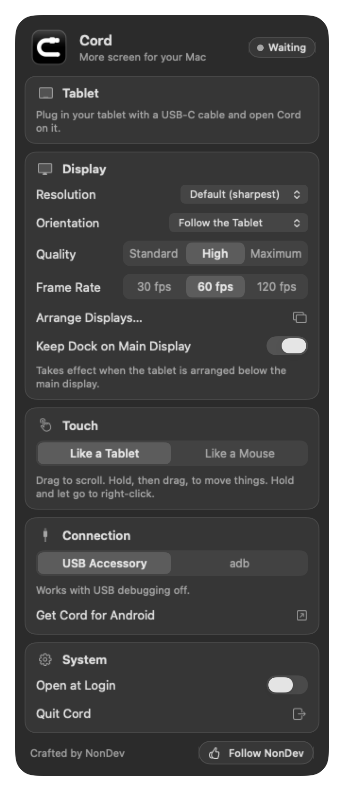

# Cord

**More screen for your Mac.** Cord turns the Android tablet you already own into an extra display, over the USB-C cable that charges it.

[ภาษาไทย](README.th.md) · [ninjait07.github.io/cord](https://ninjait07.github.io/cord/)

## What it does

- **One cable.** Picture and touch travel over USB-C, not Wi-Fi. It works with no network at all, and the tablet charges while you work.
- **A real display.** macOS sees the tablet as one more display: drag windows onto it, place it anywhere in Arrange Displays, choose its resolution.
- **Sharp.** Sent at the tablet's own resolution with Retina-style scaling, at up to 120 fps on tablets that can show it.
- **Touch that feels right.** Tap to click, drag to scroll, hold then drag to move things. Or switch to a mouse feel.
- **Any way up.** Landscape, portrait, upside down, or follow the tablet as you turn it.
- **The Dock stays home.** Put a display below your Mac's and macOS moves the Dock onto it. With Cord the Dock stays where it was.
- **No developer mode.** USB debugging can stay off.
- **Tiny.** The Mac app is a 1 MB download that sits in the menu bar. The tablet app is under 1 MB.

## Get started

1. Download **Cord for Mac** from [Releases](https://github.com/ninjait07/cord/releases/latest), open it, and drag Cord into your Applications folder.
2. Open Cord and allow **Screen Recording** and **Accessibility** when macOS asks.
3. Install **Cord** on the tablet from [Google Play](https://play.google.com/store/apps/details?id=com.nonbannawat.cord).
4. Connect the two with a USB-C cable and tap **Allow** on the tablet. It becomes a display.

You need a Mac with Apple Silicon and macOS 14 or later, an Android tablet (or phone) on Android 8 or later, and a USB-C cable that carries data. Some charge-only cables do not.

The Mac app is signed with a Developer ID and notarized by Apple, so it opens without security warnings.

## Touch

| On the tablet | Like a Tablet (default) | Like a Mouse |
| --- | --- | --- |
| Tap | Click | Click |
| Double tap | Double-click | Double-click |
| Drag | Scroll, with a glide when you let go | Move the pointer with the button down |
| Hold, then drag | Move a window, drag a file, select text | |
| Hold and let go | Right-click | Right-click |
| Two-finger tap | Right-click | Right-click |
| Two-finger drag | Scroll | Scroll |

The pointer stays out of the way while your fingers are on the glass, and goes back to where it was when you lift them.

## The panel

Cord lives in the menu bar. Everything it can do is on one panel.

- **Resolution**: how much fits on the tablet. Default is the sharpest.
- **Orientation**: Follow the Tablet, Landscape, Portrait, or either one flipped.
- **Quality** and **Frame Rate**: change them while it runs.
- **Keep Dock on Main Display**: on by default. It applies when the tablet is arranged below the main display.
- **Touch**: Like a Tablet, or Like a Mouse.

## Price

| | |
| --- | --- |
| **Cord for Mac** | Free, and stays free. |
| **Cord for Android** | Free for the first 7 days with everything working. After that, one ฿99 payment on Google Play keeps it for good. No subscription. |

## Permissions & privacy

The picture travels from the Mac to the tablet over USB and nowhere else. Cord has no accounts, no analytics and no ads.

- **Screen Recording**: to send the picture of the extra display Cord creates. Nothing is saved.
- **Accessibility**: to turn your touches into clicks and scrolling, and to keep the Dock in place.

The Mac app never connects to the internet. The tablet app talks to Google Play about the purchase, and nothing else. See [PRIVACY.md](PRIVACY.md).

## Good to know

- **Cable only.** There is no wireless mode, on purpose.
- **One tablet at a time.** A second tablet waits its turn.
- **Apple Silicon Macs only**, for now.
- **Sound stays on the Mac.** Cord sends the picture only.
- **Copying files to the tablet.** While Cord is open on the Mac, the tablet you use as a display does not show up for file transfer. Quit Cord, then plug the cable in again.
- **Nothing happens when you plug in.** Open Cord on the tablet. If the panel on the Mac shows **Use “…” as a Display**, press it once.
- **The picture is wrong on your tablet.** A few tablets decode H.264 better than HEVC. In Terminal: `defaults write com.nonbannawat.cord codec avc`, then reconnect.

## Follow

Updates, demos and new projects are posted on the **[NonDev Facebook page](https://www.facebook.com/nondev07/)**. Follow along, ask questions, or suggest features there.

---

Cord is free to download and use; the tablet app is unlocked with a one-time purchase after its trial. © 2026 NonDev. Crafted by NonDev 🇹🇭
